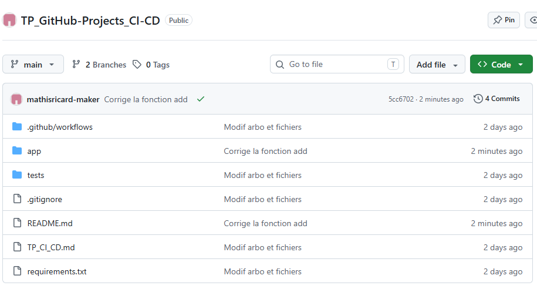
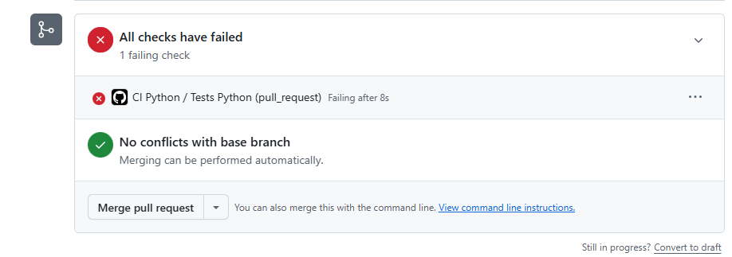
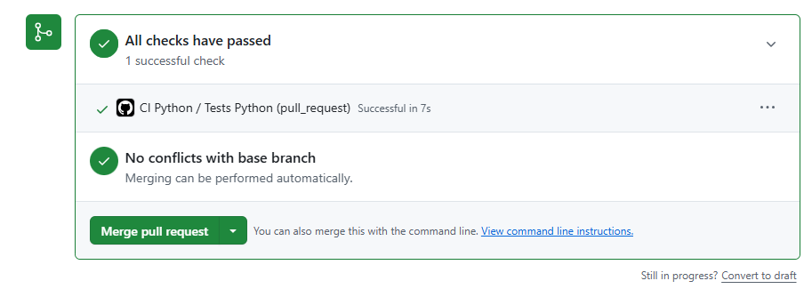

# Projet support — calculatrice Python

Projet Python utilisé dans le TP CI. Il contient des fonctions de calcul, six tests `pytest` et un workflow GitHub Actions. Le workflow vérifie automatiquement le code ; il ne construit ni ne déploie une application.

## Lancer les tests en local

À la racine du dépôt, créez et activez un environnement virtuel.

**Linux/macOS :**

```bash
python3 -m venv .venv
source .venv/bin/activate
python -m pip install -r requirements.txt
python -m pytest -v
```

**Windows PowerShell :**

```powershell
py -m venv .venv
.\.venv\Scripts\Activate.ps1
python -m pip install -r requirements.txt
python -m pytest -v
```

Résultat attendu : `6 passed`. Le dossier `.venv` et les fichiers de cache sont exclus du dépôt par `.gitignore`.

## Compte rendu :

URL Dépôt : https://github.com/mathisricard-maker/TP_GitHub-Projects_CI-CD
- La branche principale est "main"


L'échec intentionnel suivant à été créé à cause de la modification de la fonction d'addition "a + b" qui a été remplacé par "a - b". En faisant une pull request et prennant la bonne solution le problème est réparé.

**Arborescence du projet :**



---

### Erreur de la CI à cause du pull request :

Screenshot d'erreur du test après le pull request :



Screenshot après correction :




**RICARD Mathis**